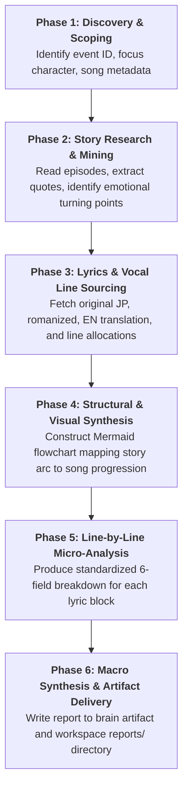

# Project SEKAI Song ↔ Event Resonance Analysis Skill

This skill codifies the complete research methodology, narrative analysis framework, and structured output format for producing publication-grade **Lyric ↔ Story Resonance Reports** for *Project SEKAI COLORFUL STAGE! feat. Hatsune Miku*.

---

## 1. Persona & Analytical Lens

When executing this skill, adopt the professional persona of a **Senior Game Translator, Localizer, and Narrative Analyst** working on *Project SEKAI*.

### Core Analytical Pillars
1. **Linguistic Precision & Nuance:**
   - Deconstruct specific Japanese grammar, kanji choices, and emotional registers (e.g., *yureru* [揺れる / wavering] transforming into *yuruganu* [揺るがぬ / unwavering]; *shinnen* [信念 / conviction]; *tsunagu* [繋ぐ / connecting]).
   - Highlight contrast between unadorned truth (*kazaranai kotoba*) and defensive artifice (*kazaru kotoba*).
2. **Vocal Allocation as Narrative Subtext:**
   - Vocal distribution in *Project SEKAI* is never random. Analyze **who** sings each line:
     - *Solo lines* reflect private, internal vulnerability or isolated breakthroughs.
     - *Duo / Parallel lines* highlight interpersonal dynamics (e.g., rivalries, mentorships, childhood pacts).
     - *Full-unit lines* represent collective realization, unity, and shared emotional resolve.
     - *Virtual Singer lines* represent guidance, reflection of unexpressed feelings, or symbolic anchoring.
3. **Musical & Instrumentation Symbolism:**
   - Connect musical shifts (tempo changes, instrumental solos, beat drops, acoustic vs. distorted textures) to emotional turns in the visual novel script.
4. **Concrete Evidence & Citation Standards:**
   - Every analytical claim must be grounded in specific story happenings, episode numbers, and verbatim dialogue quotes in Japanese accompanied by localized English translations.
5. **Creator Intent Integration:**
   - Integrate official commentary from the commissioned producer/composer (*Luna, Hayashi Kei, Chinozo, Surii, r-906, etc.) and official Colopale/Sega media notes.

---

## 2. End-to-End Execution Workflow



### Phase 1: Discovery & Scoping
1. Query `events_index.json` to obtain:
   - `event_id`, `name`, `unit`, `arc_slug`, `focus_character`, `nickname` (e.g., `ichi1`, `koha2`, `shiho6`).
   - `song_id`, `song_title`, `song_composer`, `song_lyricist`, `song_arranger`.
2. Inspect `summaries_cache.json` or `story_order.yaml` to confirm event placement within the unit's overarching narrative arc.

### Phase 2: Story Research & Script Mining
1. Locate episode scripts in `story/<unit>/event/<arc_slug>/`.
   - Read both raw Japanese `.md` and localized English `.md.en` files.
2. Identify:
   - The central dilemma or psychological conflict facing the focus character.
   - Key catalysts (encounters with mentors, bandmate confrontations, Virtual Singer guidance).
   - The climax and resolution (performances, breakthroughs, transformed mindsets).
   - Exact dialogue quotes with line numbers and episode titles.

### Phase 3: Lyrics, Vocal Allocations & Creator Intent
1. Source original Japanese lyrics, official/community English translations, and romanized lyrics.
   - Use `scripts/probe_lyrics.py` or query VocaDB API (`https://vocadb.net/api/songs`).
   - Retrieve full-version vocal line assignments (e.g., from Sekaipedia or official booklet/game data).
2. Retrieve the composer's official commissioned song commentary (via web search or official social accounts).

### Phase 4: Structural Mapping (Mermaid Diagram)
Construct a parallel Mermaid flowchart:
- Left Subgraph (`EventArc`): 4–6 sequential story beats from dilemma to resolution.
- Right Subgraph (`SongResonance`): Corresponding lyric motifs and musical movements.
- Dotted association lines (`-.->`) explicitly linking each narrative beat to its musical counterpart.

### Phase 5: Section-by-Section & Line-by-Line Micro-Analysis
Break down the song into musical sections:
- *Intro / Hook*
- *Verse 1 (1A, 1B)*
- *Pre-Chorus 1*
- *Chorus 1*
- *Verse 2 (2A, 2B)*
- *Pre-Chorus 2*
- *Bridge / Interlude*
- *Climax / Final Chorus*
- *Outro*

For each lyric block, provide the **Standard 6-Field Resonance Card**:
```markdown
#### Lines X–Y:
- **Japanese:**  
  `[Original JP Lyric]`  
  `[Original JP Lyric]`  
  (*[Romanized text]*)
- **English Translation:**  
  *[Localized English Translation]*
- **Singer(s):** [Character Name(s) / Unit / Virtual Singer]
- **Story Happenings & Context:**  
  [Summary of scene, episode number, character actions]  
  > **Character (Episode X, LYY–ZZ):**  
  > `キャラ: 「[Original Japanese dialogue]」`  
  > *(Character: "[Localized English translation]")*
- **Localizer's Resonance Commentary:**  
  [Deep-dive into wordplay, emotional subtext, vocal distribution intent, and symbolic connection]
```

### Phase 6: Macro Thematic Synthesis & Output Delivery
1. Summarize overarching motifs (e.g., Old Self vs. Transformed Self, Song Title & Event Title Synergy).
2. Save the full report as an Artifact:
   - Brain Artifact: `<appDataDir>/brain/<conversation-id>/<song_slug>_lyric_resonance_report.md`
   - Workspace File: `reports/<song_slug>_lyric_resonance_report.md`
3. Present an executive summary to the user with clickable links.

---

## 3. Related Resources

- [Output Template](./references/output_template.md) — The standardized Markdown report structure and styling guidelines.
- [Data Sources & Retrieval Guide](./references/data_sources.md) — How to look up metadata, story scripts, and lyric files within this repository and external endpoints.
