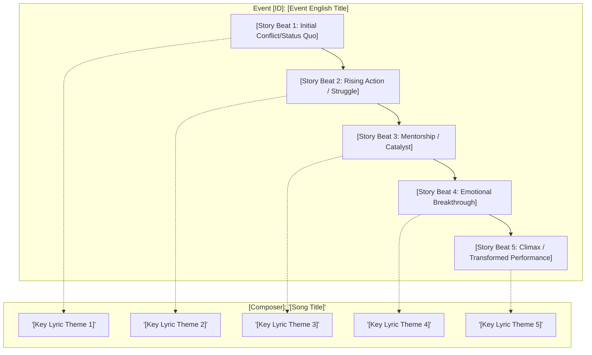

# Song ↔ Event Resonance Report Output Template

Use this template to generate standardized, publication-grade resonance reports.

```markdown
# Lyric ↔ Story Resonance Report: "[Song Title]" ([Song Title in Kanji/Katakana])
**Game:** Project SEKAI COLORFUL STAGE! feat. Hatsune Miku  
**Unit:** [Unit Name] × [Virtual Singer Name]  
**Event:** Event [ID] — 「[Event Title (JP)]」 ([Official or Localized English Event Title])  
**Focus Character:** [Character Name] ([Kanji Name]) — Focus Event #[N] (`[nickname]`)  
**Music / Lyrics / Arrangement:** [Composer / Lyricist / Arranger Name]  
**SEKAI Version Vocals:** [List of singers with line assignments reference]  
**Translation & Localization Analysis:** Professional Game Localization & Narrative Analysis  
**Lyric Translation Attribution:** [Translator / Source citation, e.g., Vocaloid Lyrics Wiki / Sekaipedia]

---

## Executive Summary & Narrative Context

[2–4 paragraphs summarizing:
- The premise of the event and the central dilemma/conflict.
- The role of the focus character and their interactions with unit members/mentors.
- Key plot breakthroughs, performance milestones, or emotional epiphanies.
- How the event fits into the character's long-term developmental trajectory.]

### Official Creator / Producer Commentary
> "[Original Japanese commentary from composer/lyricist if available]"  
> 
> *("[Localized English translation of creator commentary]")*



---

## Line-by-Line Lyric & Story Resonance Analysis

### Section [N]: [Section Name, e.g., Intro / Verse 1A / Chorus 1] — [Thematic Subtitle]

```
[Japanese Lyrics Block]
```

#### Lines [X–Y]:
- **Japanese:**  
  `[Japanese Line 1]`  
  `[Japanese Line 2]`  
  (*[Romanized Line 1] / [Romanized Line 2]*)
- **English Translation:**  
  *[Localized English Translation]*
- **Singer(s):** [Character Name(s) / Unit / Virtual Singer]
- **Story Happenings & Context:**
  [Detailed scene context, describing the exact events, emotional climate, and character interactions.]
  > **Character (Episode [N], L[X]–[Y]):**  
  > `[Speaker]: 「[Original Japanese dialogue]」`  
  > *([Speaker]: "[Localized English translation]")*
- **Localizer's Resonance Commentary:**
  [Analytical deep-dive into:
  - Specific Japanese wordplay, vocabulary nuances, or grammatical structures.
  - Why this specific character/combination sings this line.
  - Emotional and narrative resonance with the character's core trauma or growth.
  - Sonic / musical mirroring of the narrative beat.]

[Repeat for all sections of the song: Intro, Verse 1, Pre-Chorus 1, Chorus 1, Verse 2, Pre-Chorus 2, Bridge, Climax/Final Chorus, Outro]

---

## Thematic & Narrative Synthesis

```
  ┌────────────────────────────────────────────────────────┐
  │                 THEMATIC EVOLUTION                     │
  ├────────────────────────────────────────────────────────┤
  │  [Old Mindset / Starting State]                        │
  │  • [Trauma, hesitation, misconception, defensive armor]│
  │                         │                              │
  │                         ▼                              │
  │  [Transformed Mindset / Resolution]                    │
  │  • [Breakthrough, shared conviction, mature artistry]  │
  └────────────────────────────────────────────────────────┘
```

### 1. Linguistic Motifs & Wordplay Deep-Dive
[Analyze overarching verbal motifs, e.g., shinnen, yureru vs. yuruganu, tsunagu, kazaranai kotoba, etc.]

### 2. Musical & Instrumental Architecture
[Analyze how the rhythm, tempo, specific instrumental solos (guitar/bass/keys/drums), or dynamics match the narrative arc.]

### 3. Localization & Character Arc Significance
[Concluding reflection on what this milestone represents for the character's lifelong journey and the unit's future.]
```
